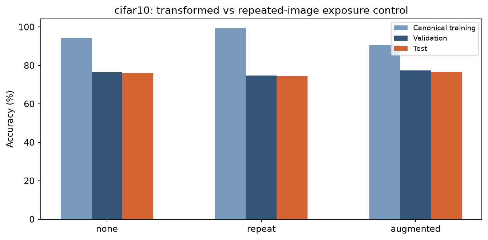
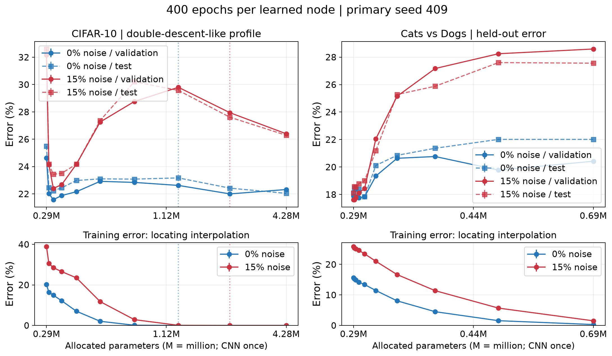
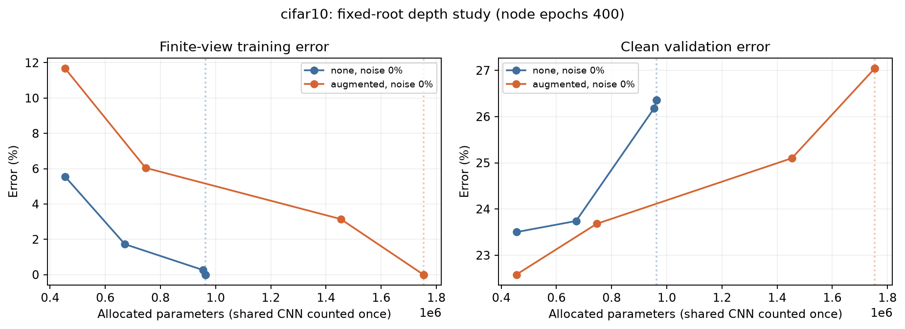

# Neural Correction Trees: Capacity, Augmentation and Double Descent

**ELL409 (Machine Learning), IIT Delhi.** A PyTorch research project on **recursive neural correction trees**. In these models, small MLP nodes learn to fix a frozen CNN classifier's mistakes on **CIFAR-10** and **Cats vs Dogs**. The project uses them to study memorization, double descent, data augmentation, ensembling, bias/variance and loss landscapes.

## Highlights

- **Designed and implemented a new model family.** Each parent node spawns a child that corrects false negatives and a child that corrects false positives. The children's hard decisions combine upward through signed coefficients, which are fitted by a linear program with an Adam fallback. CIFAR-10 uses ten one-vs-rest trees; Cats vs Dogs uses one binary tree.
- **Ran six iterations of controlled experiments (V1 to V6).** Each version tested a hypothesis left open by the one before: a shared trained CNN, then pixel and local-CNN nodes, a partly trained CNN, frozen random features, 15% label noise, and finally input augmentation. Negative results and parameter-matched baseline controls are kept.
- **Showed memorization beyond a frozen root.** Correction trees reach **100% training accuracy** on top of an imperfect frozen CNN (CIFAR-10 at depth 8, Cats vs Dogs at depth 12).
- **Measured double-descent-like behaviour.** With 15% CIFAR-10 label noise, test error across widths 2 / 8 / 128 / 1,024 was **32.6% / 23.4% / 30.2% / 26.3%**. A 1,200-epoch, three-seed follow-up confirmed that error keeps falling past interpolation. Most of that later gain came from wider root classifiers, not deeper trees.
- **Built the augmentation, ensemble and analysis pipeline.** It covers deterministic crop/flip view banks (135k CIFAR and 56k Cats views), bootstrap majority-vote ensembles, an empirical Brier bias/variance decomposition over sample size and epochs, and 2-D loss-landscape slices with gate-flip maps.
- **Engineered for long GPU runs on a 4 GB laptop GPU (RTX 2050).** The pipeline has resumable optimizer and RNG state, hash-locked study definitions, an OS-level single-worker lock, cached CNN features, unit tests, and a verifier that hash-checks every file in this repository.

## Results so far: augmentation study

Each row is a frozen-CNN + depth-1, width-64 correction-tree reference model. Test sets were evaluated once.

| Dataset | Training images | Train % | Validation % | Test % |
| --- | --- | ---: | ---: | ---: |
| CIFAR-10 | original only | 94.46 | 76.50 | 76.13 |
| CIFAR-10 | 3× repeated originals | 99.26 | 74.78 | 74.44 |
| CIFAR-10 | **original + 2 augmented views** | 90.67 | **77.42** | **76.69** |
| Cats vs Dogs | original only | 84.25 | 81.47 | 81.17 |
| Cats vs Dogs | 3× repeated originals | 86.50 | 80.91 | 80.87 |
| Cats vs Dogs | **original + 2 augmented views** | 83.74 | 81.30 | **81.64** |

Augmentation gives the best test accuracy on both datasets. Showing the same originals three times instead raises training accuracy but lowers test accuracy, which is overfitting rather than learning.



| Label-noise width study (V5) | Depth vs memorization (V6) |
| --- | --- |
|  |  |

> **Status (2026-10-20):** 85 of the 166 configurations in the V6 study are complete. The width sweep, ensemble and bias/variance figures will fill in as the remaining runs finish. [Results and limitations](docs/RESULTS_AND_LIMITATIONS.md) states exactly what the current evidence does and does not show.

## Tech stack

Python · PyTorch (CUDA) · NumPy · SciPy (linear programming) · Matplotlib · pytest

## Repository layout

| Folder | Contents |
| --- | --- |
| `neural_tree/ell409_tree/` | V1 package: shared CNN, recursive correction nodes, training, interpretation, pruning. |
| `neural_tree_v2/v2_tree/` | V2: pixel and local-CNN trees with fixed-root and parameter-matched controls. |
| `neural_tree_v3/` – `neural_tree_v5/` | Partly trained CNN features, frozen random-CNN features, label-noise width studies. |
| `neural_tree_v6/` | Current study: augmentation, voting ensembles, bias/variance, loss landscapes, tests. |
| `followup/` | Measurements (CSV/JSON) and figures for the V6 study. |
| `figures/` | Selected figures from earlier versions. |
| `docs/` | [Experiment journey](docs/EXPERIMENT_JOURNEY.md), [methods](docs/FOLLOWUP_METHODS.md), [results and limitations](docs/RESULTS_AND_LIMITATIONS.md), [figure guide](docs/FIGURE_GUIDE.md), [reproduction](docs/REPRODUCE.md). |
| `report/` | PDF report from the first assignment. |
| `archives/` | Full earlier submission, extra evidence and saved model weights (ZIP). |

## Reproduce

```bash
pip install -r requirements.txt   # install a torch/torchvision pair for your platform first
python tools/verify_repository.py # checks every file hash and archive
pytest neural_tree_v6/tests
```

[docs/REPRODUCE.md](docs/REPRODUCE.md) covers training, image inference and re-plotting from saved data. Raw datasets, feature caches and optimizer checkpoints are not included.

## Scope

The project adapts established methods (CNNs, bagging, double-descent analysis). It does not claim to invent them. Its contribution is the correction-tree design and the controls that show where learning happens and where the tree helps or fails. Test partitions were reused across versions, so test results are exploratory.
