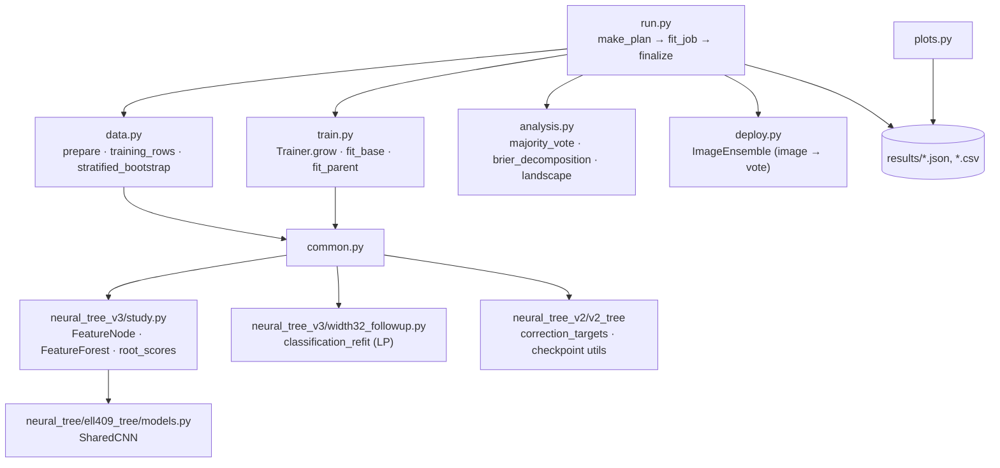

# Code walkthrough

This page says where each part of the design lives in the code. Read [DESIGN.md](DESIGN.md) first for the ideas.

## Suggested reading order (about 30 minutes)

| # | File | What to look at |
| - | --- | --- |
| 1 | [neural_tree_v2/v2_tree/models.py](../neural_tree_v2/v2_tree/models.py) | `correction_targets` (the A/B target table) and `ImageNode.forward` (the corrected-score formula). About 50 lines. |
| 2 | [neural_tree_v3/study.py](../neural_tree_v3/study.py#L30-L106) | `root_scores` (frozen CNN as root), `FeatureNode` / `FeatureForest` (the node class used by the final model). |
| 3 | [neural_tree_v6/train.py](../neural_tree_v6/train.py) | The final training algorithm: `fit_base`, `fit_parent`, `Trainer.grow`. 178 lines. |
| 4 | [neural_tree_v3/width32_followup.py](../neural_tree_v3/width32_followup.py#L16-L55) | `classification_refit`, the repaired parent linear program. |
| 5 | [neural_tree_v6/data.py](../neural_tree_v6/data.py) | Deterministic augmentation views and the stratified bootstrap. |
| 6 | [neural_tree_v6/analysis.py](../neural_tree_v6/analysis.py) | Majority vote, bias/variance decomposition, loss landscape. |
| 7 | [neural_tree_v6/run.py](../neural_tree_v6/run.py) | How the 166-configuration experiment plan is built and run. |

## How the final (V6) code fits together

The final study reuses the node classes from V3 and utilities from V2 and V1, which it imports by folder name through `sys.path` ([common.py](../neural_tree_v6/common.py#L8-L19)). That is why the version folders keep their original names.

## Concept → code

### Model

| Concept | Code |
| --- | --- |
| A/B correction targets and "ignore" masks | [`correction_targets`](../neural_tree_v2/v2_tree/models.py#L8). The V1 copy is in [models.py](../neural_tree/ell409_tree/models.py#L8). |
| Corrected score `base + α[A≥0] − β[B≥0] + offset` | [`FeatureNode.forward`](../neural_tree_v3/study.py#L70). `alpha.clamp_min(0)` enforces α, β ≥ 0. |
| Frozen CNN as root: class margin `logit_c − max_{k≠c} logit_k` | [`root_scores`](../neural_tree_v3/study.py#L30), [`FrozenRootScore`](../neural_tree_v3/study.py#L51) |
| Correction node MLP `128 → width → 1` | [`FeatureScore`](../neural_tree_v3/study.py#L41) |
| One-vs-rest forest, prediction = argmax of root scores | [`ImageForest`](../neural_tree_v2/v2_tree/models.py#L77), extended by [`FeatureForest`](../neural_tree_v3/study.py#L97) |
| Shared CNN (32/64/128 channels, global average pool → 128 features) | [`SharedCNN`](../neural_tree/ell409_tree/models.py#L15) |
| Training the CNN only until 80% training accuracy | [`train_to_target`](../neural_tree_v3/study.py#L148) |
| Parameter and active-node counting | [`capacity`](../neural_tree_v6/common.py#L50), [`active_nodes`](../neural_tree_v6/common.py#L40) |

### Training (final version)

| Step | Code |
| --- | --- |
| Grow one tree recursively: train base, stop or create A/B children, fit parent, reject harmful refits | [`Trainer.grow`](../neural_tree_v6/train.py#L117) |
| One tree per class (one binary tree for Cats) | [`Trainer.fit`](../neural_tree_v6/train.py#L150) |
| Train one node: class-balanced BCE, keep the best (errors, loss) epoch, resumable | [`fit_base`](../neural_tree_v6/train.py#L16) |
| Parent fit: try the exact LP, fall back to projected Adam | [`fit_parent`](../neural_tree_v6/train.py#L67) |
| Repaired LP: maximise margin m ≤ 1, then minimise α+β at margin m/2, verify in float32 | [`classification_refit`](../neural_tree_v3/width32_followup.py#L16) |
| Original V1 LP (margin fixed at 1) for comparison | [`exact_correction_candidate`](../neural_tree/ell409_tree/train.py#L231) |
| Original V1 tree trainer | [`TreeTrainer.grow`](../neural_tree/ell409_tree/train.py#L268) |

### Assignment 2 experiments

| Question | Code |
| --- | --- |
| Augmented views: reflect-pad, random crop, flip, seeded per (image, view) | [`augmented_pixels`](../neural_tree_v6/data.py#L6) |
| CNN features for every view, computed once and cached | [`prepare`](../neural_tree_v6/data.py#L44) |
| `none` / `repeat` / `augmented` training sets | [`training_rows`](../neural_tree_v6/data.py#L129) |
| Stratified bootstrap by original image | [`stratified_bootstrap`](../neural_tree_v6/data.py#L20) |
| 15% label-noise control (reuses the V5 noise map) | [`labels_for_job`](../neural_tree_v6/run.py#L76). The noise map itself comes from [`corrupt_labels`](../neural_tree_v5/noise_study.py#L37). |
| The full experiment grid (widths, depths, epochs, sample fractions, noise) | [`make_plan`](../neural_tree_v6/run.py#L24), settings in [config.json](../neural_tree_v6/config.json) |
| Train and measure one configuration | [`fit_job`](../neural_tree_v6/run.py#L87) |
| Majority vote and pairwise disagreement | [`majority_vote`](../neural_tree_v6/analysis.py#L7), [`disagreement`](../neural_tree_v6/analysis.py#L30) |
| Bias/variance (Brier) decomposition, with the identity asserted | [`brier_decomposition`](../neural_tree_v6/analysis.py#L14) |
| Loss-landscape directions and grid | [`normalized_directions`](../neural_tree_v6/analysis.py#L36), [`landscape`](../neural_tree_v6/analysis.py#L53) |
| Group results into ensemble and bias/variance tables | [`summarize`](../neural_tree_v6/analysis.py#L91) |
| One-time test evaluation after all training | [`evaluate_reference`](../neural_tree_v6/run.py#L157), [`finalize`](../neural_tree_v6/run.py#L197) |
| Image → prediction with a saved single model or 3-member ensemble | [`deploy.py`](../neural_tree_v6/deploy.py) |
| Noisy 4,000-image subset width study (report §7) | [`subset_capacity_study.py`](../neural_tree_v6/subset_capacity_study.py) |
| Figures | [`plots.py`](../neural_tree_v6/plots.py) |

### Assignment 1 extras (V1 package)

| Topic | Code |
| --- | --- |
| Dataset preparation, duplicate-aware splits | [`ell409_tree/data.py`](../neural_tree/ell409_tree/data.py) |
| End-to-end pipeline: CNN → features → trees → width sweep → pruning → plots | [`pipeline`](../neural_tree/ell409_tree/experiments.py#L283) |
| Subtree pruning with a validation tolerance | [`prune_tree`](../neural_tree/ell409_tree/experiments.py#L99) |
| Grad-CAM and occlusion for individual nodes | [`grad_cam`](../neural_tree/ell409_tree/visualize.py#L15), [`occlusion_map`](../neural_tree/ell409_tree/visualize.py#L31) |
| Command-line entry point | [`cli.py`](../neural_tree/ell409_tree/cli.py) (`python -m ell409_tree --help`) |

`report.py`, `review.py`, `submission.py` and `packaging.py` in the V1 package only build the PDF report and the upload folder. They contain no learning logic.

## Tests

Each version folder has a `tests/` directory. The final study's tests are in [neural_tree_v6/tests/test_followup.py](../neural_tree_v6/tests/test_followup.py). They use small synthetic data and check that:

* the A/B target signs and masks are correct;
* all views of an image stay together in a bootstrap sample;
* resuming from a checkpoint matches an uninterrupted run, and a changed task is rejected;
* majority voting and the Brier identity are correct;
* the loss-landscape code restores the original weights;
* a saved deployment gives the same predictions from raw images as from cached features.
