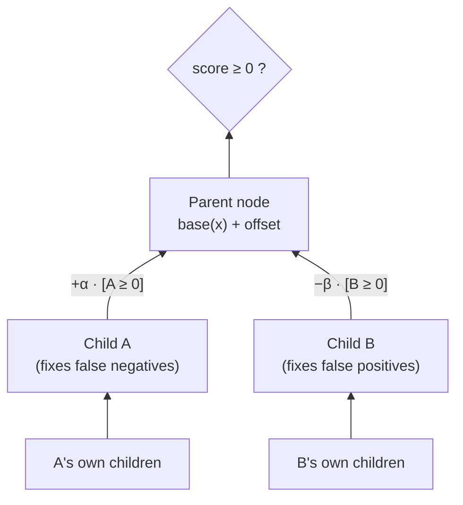
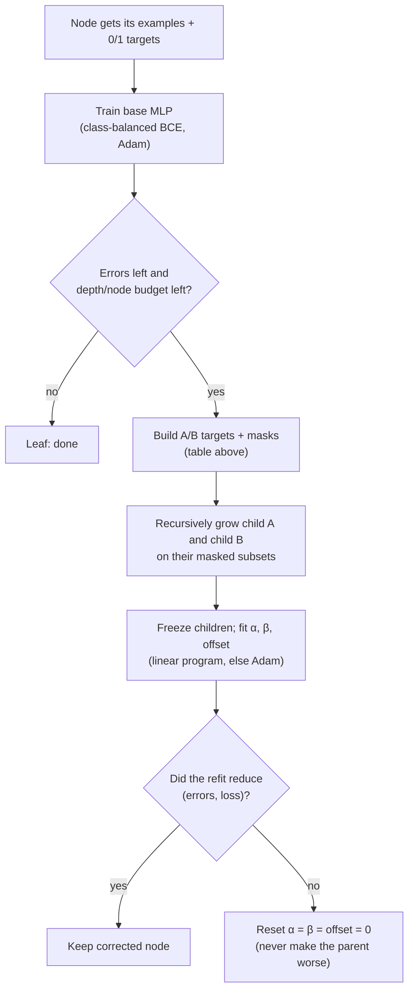
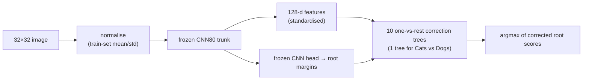

# Design: neural error-correction trees

This page explains how the model works and why it is built this way. [CODE_WALKTHROUGH.md](CODE_WALKTHROUGH.md) gives the exact function for each idea.

## 1. The idea in one paragraph

The model follows the upward error-correction construction in Jayadeva's *A Tree Type Neural Network* (course material). Each node is a small neural network that outputs a score; the node predicts class 1 when the score is ≥ 0. When a node makes mistakes, it gets two **correction children**. Child **A** learns to detect its false negatives, and child **B** learns to detect its false positives. The parent then adds A's decision and subtracts B's decision from its own score. Children can have children of their own, so the tree grows wherever errors remain.

This is **not** a decision tree that routes an input left or right. Every node sees every input, and information flows **upward** from the children into the parent's score.

## 2. One node

```text
corrected score(x) = base(x) + α · [A(x) ≥ 0] − β · [B(x) ≥ 0] + offset        α, β ≥ 0
prediction(x)      = 1 if corrected score(x) ≥ 0 else 0
```

* `base(x)` is a small MLP, `128 → width → 1` with ReLU. At a root it can instead be a frozen CNN score (see §5).
* `[A(x) ≥ 0]` and `[B(x) ≥ 0]` are the children's **hard** 0/1 decisions, each computed recursively with its own children.
* `α`, `β` and `offset` are three scalars fitted *after* the children are trained.



## 3. What each child is trained on (correction targets)

The children are trained only on the examples where they can matter. Every other example is masked out of their loss as "don't care".

| Parent prediction | True label | Child A target | Child B target |
| :-: | :-: | :-: | :-: |
| 0 | 0 | 0 | *ignore* |
| 1 | 1 | *ignore* | 0 |
| 0 | 1 (false negative) | **1** | 0 |
| 1 | 0 (false positive) | 0 | **1** |

Why the "ignore" entries are safe:

* A fires to **add** score, so it is irrelevant when the parent already says 1 and is right.
* B fires to **subtract** score, so it is irrelevant when the parent already says 0 and is right.

The table is implemented in one function, `correction_targets` ([v2_tree/models.py](../neural_tree_v2/v2_tree/models.py#L8)). It returns `(targets, mask)` for each child.

## 4. Growing and fitting a tree



The steps in detail:

1. **Train the base MLP.** It uses binary cross-entropy weighted by `#negatives/#positives`, because correction tasks are very imbalanced (for example, 7 positives out of 4,507). Adam runs with lr 0.001, with no weight decay, dropout or label smoothing. The saved checkpoint is the epoch with the fewest training errors, ties broken by lower loss.
2. **Stop or grow.** A node gets children only if it still has errors, the depth limit is not reached, the per-tree node cap is not reached (127 in the final study) and the child's task has at least one positive.
3. **Fit the parent.** With the base score `s` and the child decisions `a, b ∈ {0,1}` frozen, find `α, β ≥ 0` and `offset` so that `s + αa − βb + offset` classifies correctly.
   * **Linear program first** (SciPy HiGHS). Examples fall into only 8 groups, since (label, a, b) each take two values, so the LP needs one constraint per group at that group's worst-case score. The original LP demanded a margin of 1, which can be infeasible even when perfect classification is possible. The repaired version first **maximises a common margin m ∈ (0, 1]**, then minimises α + β while keeping a margin of m/2. The result is checked on the actual float32 predictions before it is accepted.
   * **Adam fallback** when no exact solution exists: full-batch BCE with α and β projected to ≥ 0.
   * **Safety check:** if the refit makes the node's (errors, loss) worse, the corrections are switched off.

Multi-class problems (CIFAR-10) use **ten one-vs-rest trees**. The class with the largest corrected root score wins. Cats vs Dogs uses one binary tree.

## 5. Where the features come from

Every node needs input features. The source of those features was the main design variable across the project ([EXPERIMENT_HISTORY.md](EXPERIMENT_HISTORY.md)):

| Version | Node input | Root |
| --- | --- | --- |
| V1 | 128-d features of a fully trained shared CNN (32/64/128 channels, global average pool) | trained MLP |
| V2 | raw 32×32 pixels, or a fresh small CNN at selected nodes | small trained MLP/CNN |
| V3, V5, **V6 (final)** | 128-d features of the same CNN architecture, **stopped at the first epoch above 80% training accuracy ("CNN80")** | frozen CNN80 class margin |
| V4 | 256-d features of an **untrained, random** CNN | trained width-8 MLP |

In the final design (V6) the root is the **frozen CNN80 classifier**. Its score for class *c* is `logit_c − max_{k≠c} logit_k`, so `score ≥ 0` reproduces the CNN's argmax ([`root_scores`](../neural_tree_v3/study.py#L30)). Only the correction nodes and the three parent scalars learn. Any gain over the CNN alone therefore comes from the tree.

Why stop the CNN at 80%? A fully trained CNN fits the training set almost perfectly by itself, which leaves the tree nothing to correct (V1's lesson). Stopping early keeps useful visual features but leaves real mistakes for the corrections.



## 6. Additions for Assignment 2

### 6.1 Augmentation that keeps "zero training error" well-defined

Hard correction targets depend on the parent's errors on a **fixed** training set. Random augmentation would change that set every epoch. Each original image therefore gets a **finite bank of 3 views**: the original plus 2 reflection-padded random crops (padding 4) with random horizontal flips. Each view's transform is seeded by a hash of `(seed, image id, view number)`, so it is reproducible. Augmentation is applied to pixels **before** the frozen CNN. CIFAR-10 has 135,000 views and Cats vs Dogs has 55,824.

The three training arms are:

* `none`: original images only.
* `repeat`: each original repeated 3 times. This control matches the augmented arm's exposure without adding new information.
* `augmented`: original plus 2 transformed views.

Validation and test images are never augmented.

### 6.2 Ensembles by majority vote

Three complete classifiers are trained on **stratified bootstrap** samples. Sampling is by original image, so all views of a sampled image stay together. Each complete classifier casts **one** class vote; a CIFAR member is ten binary trees but still one vote. Ties go to the smallest class index. All members share one frozen CNN at deployment ([`ImageEnsemble`](../neural_tree_v6/deploy.py#L6)).

### 6.3 Bias and variance

For member probability vectors `p_m` and one-hot label `y`, averaged over validation images, the code computes the exact identity

```text
mean_m ||p_m − y||²  =  ||mean_m p_m − y||²  +  mean_m ||p_m − mean_m p_m||²
   (member Brier)        (squared-bias proxy)      (bootstrap variance)
```

and asserts that both sides agree ([`brier_decomposition`](../neural_tree_v6/analysis.py#L14)). This is repeated for sample fractions 25/50/100% and per-child epoch budgets 20/100/400. It is conditional on the shared CNN, so the "bias" term is measured against observed labels, not the Bayes-optimal predictor.

### 6.4 Loss landscape

Two random directions are drawn per MLP weight matrix and scaled row-wise to that matrix's norm (filter normalisation, Li et al. 2018). On a 15×15 grid, the code evaluates the final classifier loss on 512 training and 512 validation examples. The CNN, root, biases and α/β stay fixed. At every grid point the hard child decisions are recomputed and the fraction that flips is recorded. The flips explain why the surface has jumps ([`landscape`](../neural_tree_v6/analysis.py#L53)).

## 7. Engineering choices (and why)

| Choice | Reason |
| --- | --- |
| Cache CNN features once, train trees on cached tensors | 4 GB laptop GPU (RTX 2050); trees train in seconds instead of re-running the CNN |
| Every checkpoint stores model + optimizer + RNG state; a task signature (hash of data, targets, config) guards resume | Runs lasted many hours and were interrupted; resuming gives the same result as an uninterrupted run (tested) |
| Larger epoch budgets resume from the smaller budget's checkpoint when the child task is identical | The 20/100/400-epoch models are snapshots of one training trajectory, which saves compute |
| Test sets are loaded only in a separate finalisation step | Model and plan choices use training and validation data only |
| Pilot run on a small subset (`pilot.json`) and unit tests before the full study | Caught bugs before spending GPU hours |
