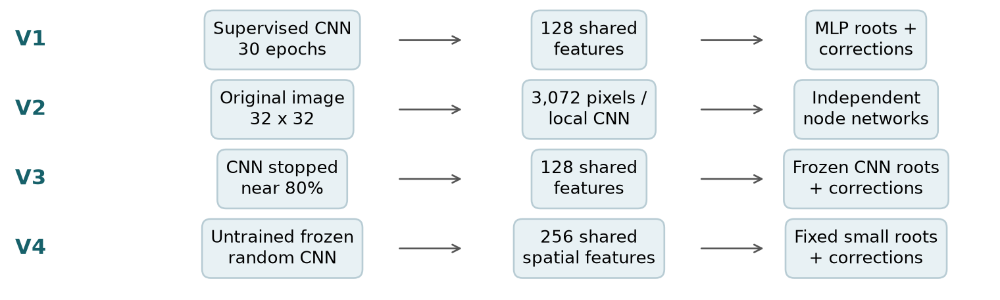

# Experiment history: V1 → V6

The project went through six versions. Each one answered a question that the previous version left open. Failed and negative results are kept on purpose: they explain why the final design looks the way it does.

| Version | What we changed | Why | What we learned |
| --- | --- | --- | --- |
| **V1** [`neural_tree/`](../neural_tree) | Trained a shared CNN fully, then built correction trees on its 128-d features. Width 64, depth ≤ 4, ≤ 31 nodes per tree. | Feasible on a 4 GB GPU: compute features once and reuse them in every node. | Near-perfect training fit (CIFAR 99.9933%, Cats 100%) and good test accuracy (80.02% / 89.94%). However, a root MLP alone did just as well, so **the strong CNN hid the tree's contribution**. |
| **V2** [`neural_tree_v2/`](../neural_tree_v2) | Nodes read raw pixels, or train their own small CNN at selected nodes. Compared against parameter-matched ordinary MLPs and CNNs. | Take learning away from the shared trunk and give it to the tree. | Trees were harder to fit. A matched plain MLP generalised **better** than the pixel tree (negative result, kept). Local-CNN nodes helped but small CNNs were better still. |
| **V3** [`neural_tree_v3/`](../neural_tree_v3) | Stopped CNN training at the first epoch above **80% training accuracy (CNN80)**, froze it, and used it as the root. Grew progressively deeper trees. | Keep useful features but leave real mistakes for the corrections. | The corrections raised training fit, which exposed a **parent-fitting bottleneck**: the margin-1 LP was often infeasible. The repaired LP (`classification_refit`) took training accuracy from 91.21% to 100% with the same node weights. |
| **V4** [`neural_tree_v4/`](../neural_tree_v4) | Frozen **random** (untrained) CNN features. | Remove supervised feature learning entirely, so all learning happens in the tree. | Corrections took training accuracy from 63% to 100% (CIFAR) and 77% to 100% (Cats). Test accuracy was much lower (48.75% / 68.10%). Some double-descent-like hints appeared, but they were not robust across seeds. |
| **V5** [`neural_tree_v5/`](../neural_tree_v5) | 15% training-label noise on CNN80 features. Width sweep 2 to 1,024, then a 1,200-epoch, 3-seed follow-up. | Label noise is the classic setting where double descent appears. | Noisy CIFAR test error went **32.6% → 23.4% → 30.2% → 26.3%** (widths 2/8/128/1,024), a double-descent-like shape. The longer follow-up showed repeatable improvement after interpolation, but mostly from **wider roots**, not the tree. |
| **V6** [`neural_tree_v6/`](../neural_tree_v6) | Assignment 2: frozen CNN80 root, finite augmented-view bank, `none`/`repeat`/`augmented` arms, bootstrap ensembles, bias/variance, loss landscapes. 166 planned + 44 repeat configurations. | Answer the four questions in the brief with controls that isolate the tree. | Augmentation helps slightly; voting always helps; variance grows with epochs; the full-data run shows no clean double descent, but a noisy 4,000-image subset does. See [RESULTS.md](RESULTS.md). |

## Recurring design principles

* **Isolate the tree's contribution.** Freeze the CNN and root, and compare against root-only and CNN-only controls.
* **Separate fitting from generalisation.** Training error locates interpolation; validation and test error decide whether double descent happened.
* **Use controls instead of assumptions.** The `repeat` arm separates "more exposure" from "new information"; label noise is a separate control from augmentation.
* **Never select on test data.** Plans and model choices use training and validation data, and test evaluation is a separate final step. The test splits were reused across versions, so test numbers are exploratory.
