# Results

The full write-ups with all caveats are the two reports in [`reports/`](../reports). This page collects the main numbers and figures. Raw measurements for Assignment 2 are in [`results/assignment2/`](../results/assignment2).

Datasets (32×32 inputs in the final study):

| Dataset | Train / validation / test |
| --- | --- |
| CIFAR-10 | 45,000 / 5,000 / 10,000 |
| Cats vs Dogs (TFDS, duplicates removed) | 18,608 / 2,326 / 2,326 |

---

## Assignment 1: Tree type network revisited

### Original V1 model (fully trained shared CNN + correction trees)

| Dataset | Classifier | Train % | Val % | Test % | Parameters |
| --- | --- | ---: | ---: | ---: | ---: |
| CIFAR-10 | CNN only | 98.56 | 79.54 | 79.08 | |
| CIFAR-10 | Root MLPs only | 99.98 | 80.44 | 80.14 | |
| CIFAR-10 | **Correction tree** | **99.9933** | 80.48 | 80.02 | 486,784 |
| Cats vs Dogs | CNN only | 99.50 | 89.68 | 89.12 | |
| Cats vs Dogs | Root MLPs only | 99.96 | 90.50 | 89.90 | |
| Cats vs Dogs | **Correction tree** | **100.00** | 90.54 | 89.94 | 336,952 |

The tree overfits the training set as required, but most of the accuracy comes from the CNN features. That finding motivated V2 to V4.

### Weaker features expose the tree

| Paired comparison (same model, children removed vs. kept) | Root only | With corrections |
| --- | ---: | ---: |
| V4 random features, CIFAR (train) | 63.36% | 100.00% |
| V4 random features, Cats (train) | 76.79% | 100.00% |
| V3 width-32, repaired parent LP vs. original LP (train) | 91.21% | 100.00% |

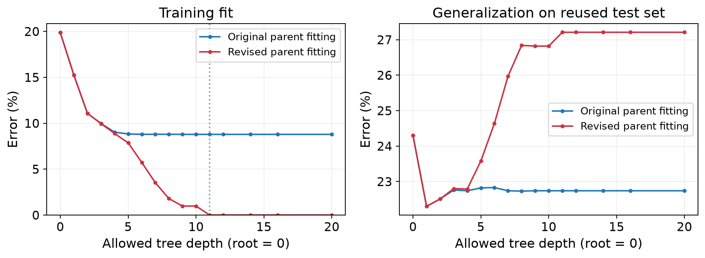

### Double descent with 15% label noise (V5)

Noisy CIFAR test error across widths 2 / 8 / 128 / 1,024 was 32.60% / 23.43% / 30.21% / 26.29%. The 1,200-epoch three-seed follow-up confirmed that error keeps falling past interpolation. That gain came mainly from wider roots, not deeper trees.

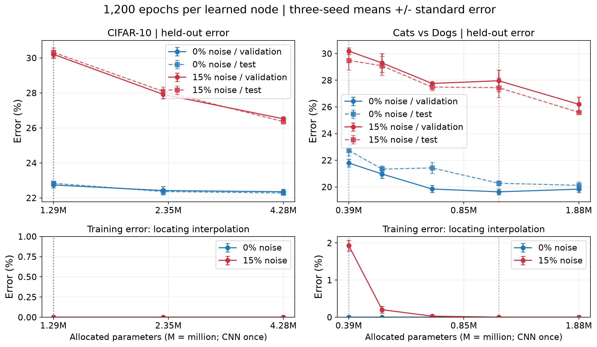

### Interpreting nodes

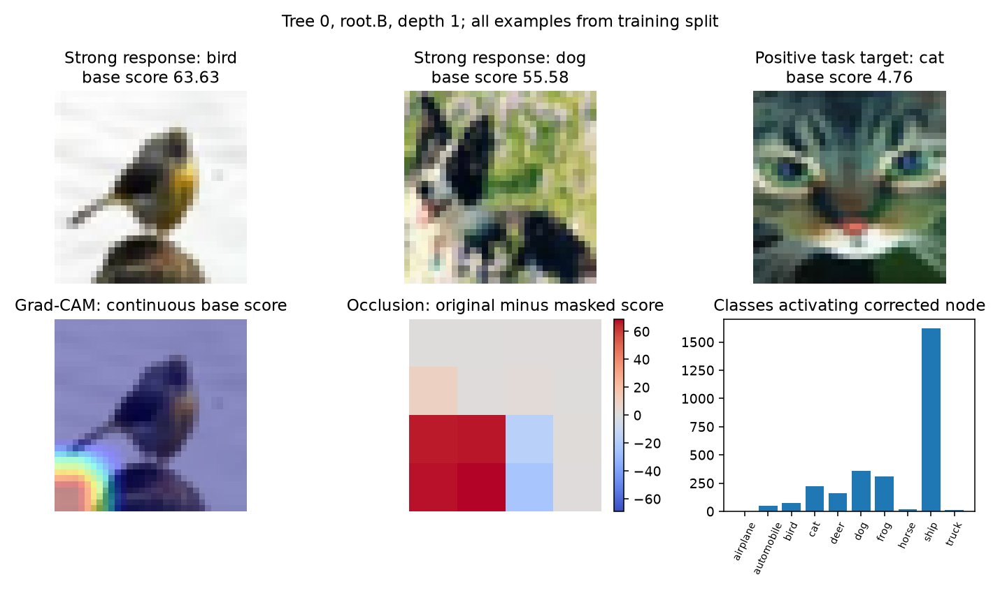

Additional figures in [`figures/assignment1/`](../figures/assignment1):

* `v1-long-sweep.png`: V1 width sweep.
* `v2-fixed-root.png`: V2 fixed-root study.
* `v3-followup-depth.png`: V3 depth study.
* `v4-primary-width.png`: V4 random-feature width study.
* `pixel-weight-templates.png`: V2 pixel weight maps.
* `compression.png`: pruning and narrower nodes.

---

## Assignment 2: Augmentation, ensembles, bias/variance and loss landscape

All 166 planned configurations and 44 selected repeats (210 total) finished on 23 October 2026. The frozen CNN80 alone scores 75.70% (CIFAR) and 82.07% (Cats) test accuracy.

### Q1. Augmentation, overfitting and double descent

Reference models (width 64, depth 1):

| Dataset | Training images | Train % | Val % | Test % |
| --- | --- | ---: | ---: | ---: |
| CIFAR-10 | original | 94.46 | 76.50 | 76.13 |
| CIFAR-10 | 3× repeated | 99.26 | 74.78 | 74.44 |
| CIFAR-10 | **augmented** | 90.67 | **77.42** | **76.69** |
| Cats vs Dogs | original | 84.25 | 81.47 | 81.17 |
| Cats vs Dogs | 3× repeated | 86.50 | 80.91 | 80.87 |
| Cats vs Dogs | **augmented** | 83.74 | 81.30 | **81.64** |

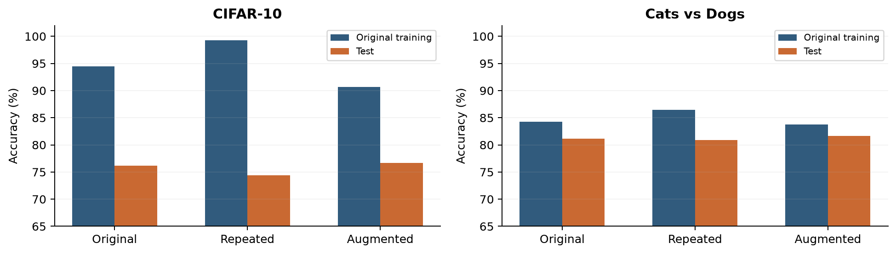

* Augmentation gives the best test accuracy on both datasets. Repeating the same images raises training accuracy and lowers test accuracy, which is plain overfitting.
* Deeper trees **memorise**: 100% training accuracy at depth 8 (CIFAR) and 12 (Cats, original images). Test accuracy drops as they do.
* On the full data, **double descent was not established** within the tested widths (up to 512).

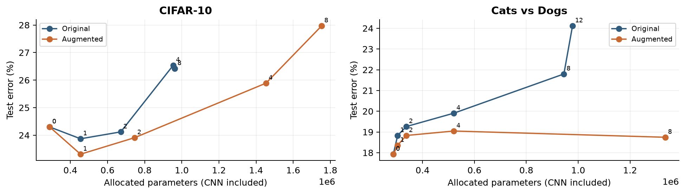
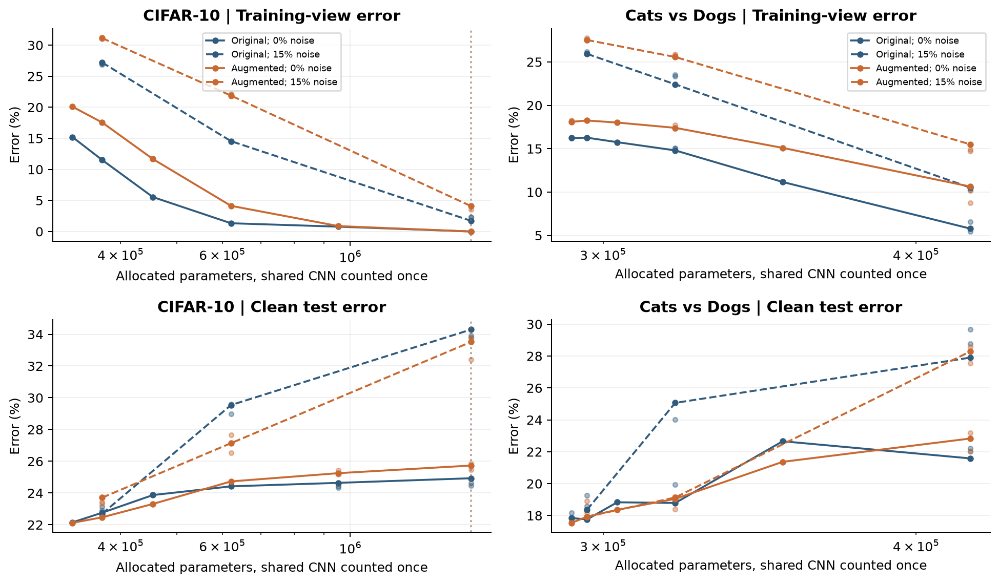

**Noisy 4,000-image subset (report §7).** With 15% label noise and correction widths 8 to 2,048, test error peaks near the interpolation threshold and then falls again in both arms. This is a double descent driven by **tree capacity**:

| Inputs | First zero-error width | Peak test error | Error at width 2,048 |
| --- | ---: | ---: | ---: |
| Original | 64 | 38.95% (w=32) | 32.32% |
| Augmented | 128 | 38.53% (w=64) | 34.30% |

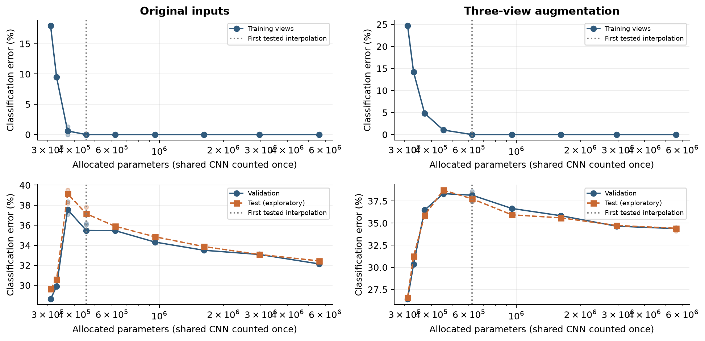

### Q2. Multiple trees with majority voting

Voting with three bootstrap members beat the first member in **all 12** settings. The largest gains came at 400 epochs on CIFAR: +1.48 points (original images) and +1.38 points (augmented).

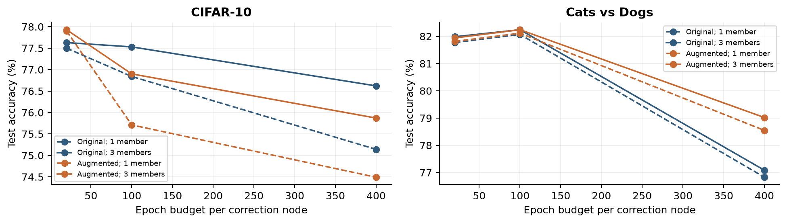

Voting over 8 test-time views per image raised the augmented CIFAR ensemble from 75.78% to 79.54% validation accuracy. The same view voting did not help the frozen CNN root.

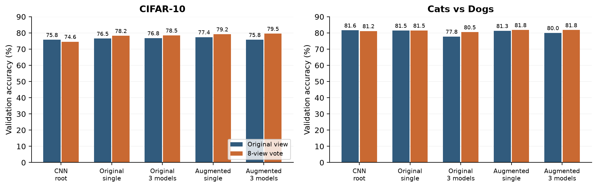

### Q3. Bias and variance versus samples and epochs

* **More epochs → more variance.** For original-view CIFAR, variance rose from 0.0034 at 20 epochs to 0.0620 at 400.
* **More samples → less variance at long training.** At 400 epochs it fell from 0.0800 with 25% of the data to 0.0620 with 100%.
* **Augmentation lowered both terms on Cats** at 400 epochs. Variance went from 0.0109 to 0.0067 and the bias proxy from 0.285 to 0.266.

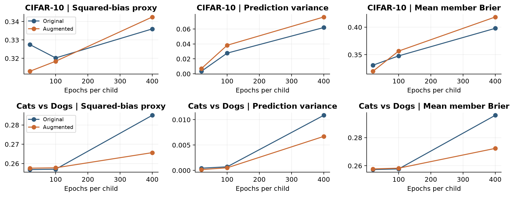
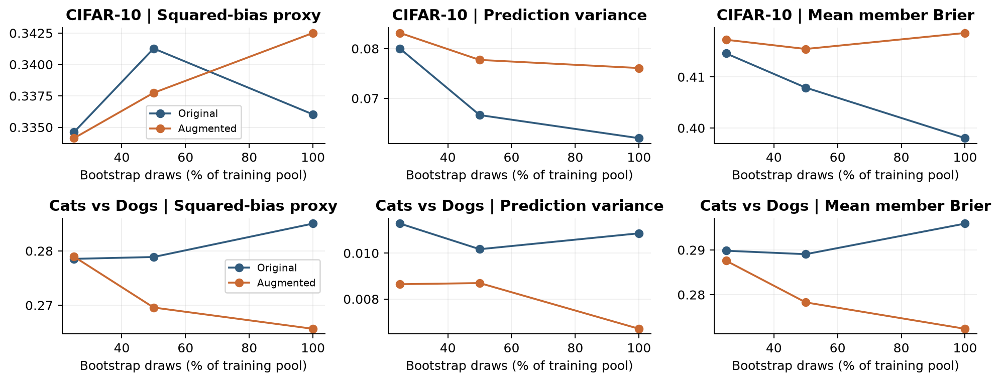

### Q4. Loss landscape

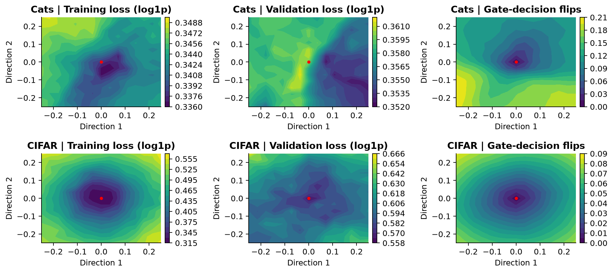

* **Hard decisions make the surface jump.** Small weight perturbations flip up to 20.7% (Cats) and 8.6% (CIFAR) of the hard node decisions, and each flip shows up as a step in the surface.
* **The saved model is not always the lowest-validation point.** For augmented CIFAR it is the lowest-loss point on the grid. On Cats, nearby points reach lower validation loss than the saved model.

### Do corrections help or hurt? (validation, augmented reference)

| Dataset | Root mistakes fixed | Correct root predictions spoiled | Net |
| --- | ---: | ---: | ---: |
| CIFAR-10 | 380 | 297 | **+83** |
| Cats vs Dogs | 92 | 99 | −7 |
